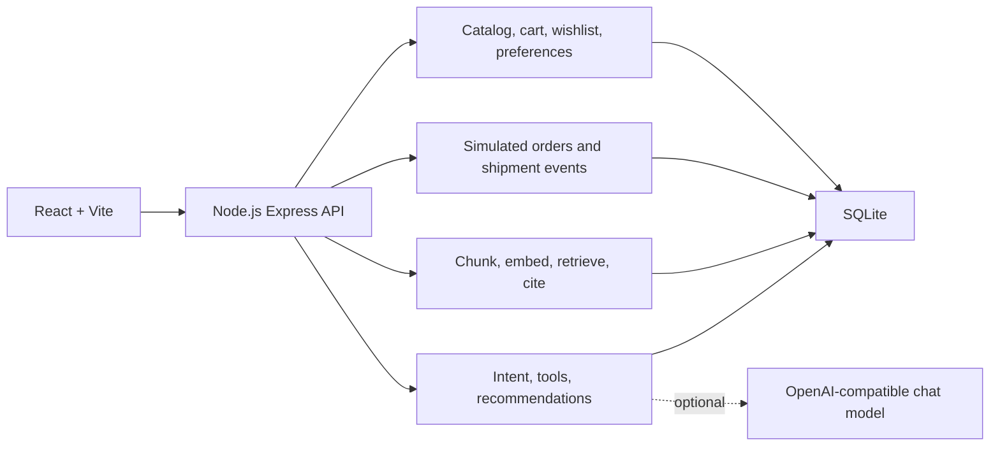

# Architecture

The API is one process. Shopping screens keep working when no model key is configured, because recommendations search the real catalog and policy answers quote retrieved document sentences.

## Responsibilities

| Piece | Responsibility |
| --- | --- |
| React UI | Login, catalog, comparison, wishlist, cart, preferences, orders, assistant, upload, audit |
| Express API | Auth, validation, ownership checks, JSON errors |
| Catalog service | Category tree, search, filters, sort, pagination, stock |
| Assistant | Reads preferences, searches products, checks inventory, reads orders, retrieves policy evidence |
| Knowledge service | PDF, Markdown, and JSON ingestion, chunking, embeddings, grounded answers |
| SQLite | Customers, catalog, inventory, orders, documents, chunks, audit records |
| Model | Optional rewrite of an answer that was already grounded in tool results |

## Data

Customers have a membership tier: Basic, Prime, or Premium. Passwords are hashed with bcrypt. Sessions are signed tokens that expire after 12 hours.

Products store id, name, category, brand, description, price, rating, a color used by the card, and specifications. Inventory is a quantity per warehouse. Availability is `IN_STOCK` above 5 units, `LOW_STOCK` from 1 to 5, and `OUT_OF_STOCK` at 0.

Orders snapshot the unit price. Shipment rows are mocked events. The assistant explains cancellation eligibility and does not cancel anything. Payment is not implemented.

A knowledge document stores name, format, version, effective date, category, region, and approval status. Seeded files are approved. Only `DEMO_UPLOADER_EMAIL` (Meera, by default) can upload. Chunk text is embedded and searched only when the document is approved.

Audit rows store the customer, endpoint, request, response, model name, tool activity, source references, outcome, and timestamp.

## Assistant flow

Product question:

1. Read the message and saved preferences.
2. Extract product type, budget, and the phrase after "for".
3. If the product type is missing, ask a clarifying question and do not invent products.
4. Search the catalog with the category and budget.
5. Check warehouse inventory and explain the recommendation with stored specifications.

Policy question:

1. Embed the question and rank approved chunks.
2. Confidence is the strength of that evidence. `HIGH` means the wording directly supports the answer. `MEDIUM` means partial support. `LOW` means there is not enough evidence, and the answer says so.
3. The cited document, section, and version come from the chunks that supplied the sentences.

Combined question, such as an order plus a cancellation policy:

1. Load only the signed-in customer's orders and shipment events.
2. Retrieve the cancellation policy.
3. Explain eligibility from those two results.

Document text is treated as evidence. It is not executed as an instruction.

## API

All protected routes use `Authorization: Bearer`. Errors use `{ "code", "message" }`.

- `POST /api/auth/login`, `GET /api/auth/me`
- `GET /api/categories`, `GET /api/products`, `GET /api/products/:id`, `GET /api/products/compare?ids=`
- `GET /api/inventory/:productId`
- `GET` and `PUT /api/preferences`
- `GET`, `POST /api/wishlist`, `DELETE /api/wishlist/:productId`
- `GET /api/cart`, `POST /api/cart/items`, `PUT` and `DELETE /api/cart/items/:productId`
- `GET /api/orders`, `GET /api/orders/:id`
- `GET /api/documents`, `POST /api/documents` multipart upload
- `POST /api/ai/recommendations`, `POST /api/ai/knowledge`, `POST /api/ai/chat`
- `GET /api/audit`

## Safeguards

- Order, cart, wishlist, preference, and audit queries are scoped to the signed-in customer.
- Another customer's order id returns a forbidden error.
- Quantity, price, date, file type, and file size are validated.
- Model output cannot introduce a product id that was not returned by search, and policy citations must match retrieved chunks.
- Model keys stay in `backend/.env`.

## Open choices

These were made so the app can be demonstrated on a laptop without extra services. They are easy to change if the review rules require them.

1. Should chat go through an OpenAI-compatible endpoint you already have? Put the key, model, and base URL in `backend/.env`.
2. Should the database be PostgreSQL with pgvector instead of SQLite and local embeddings?
3. Is the Premium account the right document uploader, or do you want a separate admin login?
4. Do you want a team name, logo, or a fixed demo script with different sample products?
